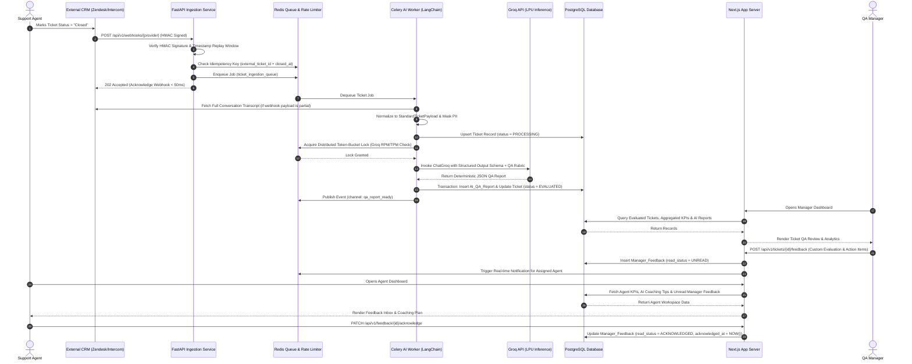
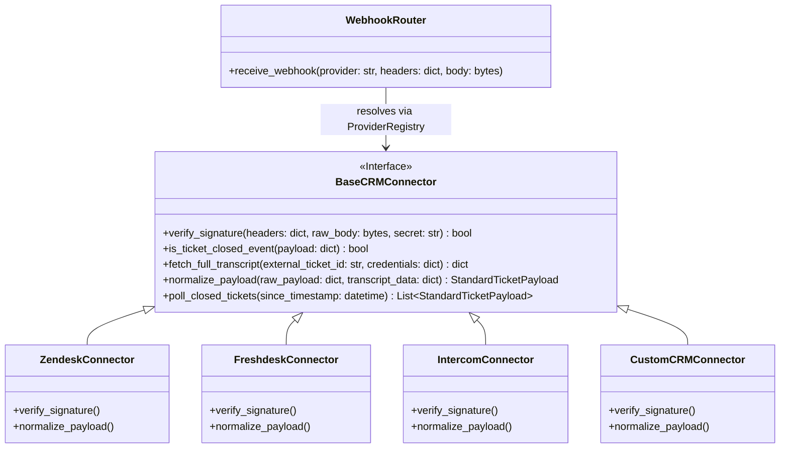
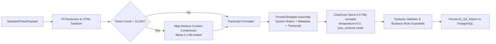
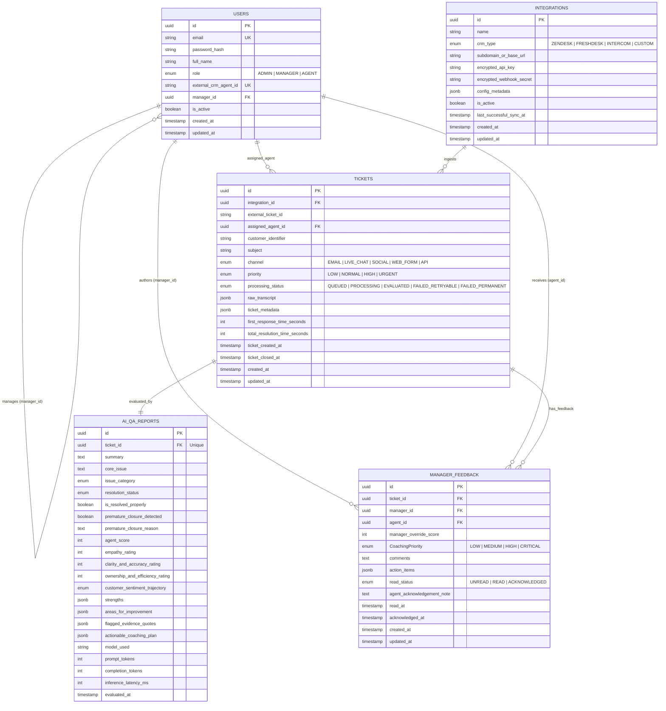

# Technical & System Architecture Documentation: Customer Support Ticket Summarization & Agent QA Platform

## 1. System Architecture & Data Flow

### 1.1 High-Level Architectural Overview

The platform follows an **Event-Driven, Decoupled Dual-Service Topology** designed to separate high-throughput external webhook ingestion and compute-intensive AI orchestration from interactive user-facing web traffic.

* **Presentation & Application Layer (Next.js 15 App Router):** Serves the Manager and Agent Dashboards, handles Role-Based Access Control (RBAC) via session middleware, executes low-latency read queries via Server Components, and handles interactive mutations (e.g., submitting manager coaching feedback, acknowledging instructions) via Server Actions and REST routes.
* **Ingestion & AI Orchestration Service (Python FastAPI):** A dedicated backend microservice responsible for receiving external CRM webhooks, verifying cryptographic signatures, normalizing proprietary CRM payloads, and executing the **LangChain + Groq** evaluation pipeline.
* **Asynchronous Messaging & Rate-Limiting Layer (Redis + Celery):** Decouples webhook ingestion from LLM inference. Incoming "Ticket Closed" events are immediately validated and pushed to a Redis-backed message broker, returning an `HTTP 202 Accepted` response to the originating CRM within 50 milliseconds.
* **LLM Inference Engine (Groq Cloud LPU):** Executes deterministic, schema-enforced inference using `ChatGroq` (`llama-3.3-70b-versatile`) with Structured Outputs (`json_schema` mode) to guarantee syntactically valid, rubric-aligned QA evaluations.
* **Persistence Layer (PostgreSQL + Prisma / SQLAlchemy):** Acts as the single source of truth. Prisma manages schema migrations and type-safe queries for the Next.js layer, while SQLAlchemy (asyncpg) provides high-concurrency write throughput for the Python AI workers.

---

### 1.2 End-to-End Sequence Diagram



---

### 1.3 Asynchronous Processing, Backpressure & Groq Rate-Limiting

External support platforms frequently close tickets in bursts (e.g., bulk-closing resolved incidents or automated ticket cleanups). Sending synchronous requests directly to Groq during webhook ingestion would result in webhook timeouts (`HTTP 504`) and `HTTP 429 Too Many Requests` errors from Groq.

| Mechanism | Architectural Design & Operational Behavior |
| --- | --- |
| **Non-Blocking Webhook Ingestion** | The webhook receiver performs zero database writes and zero LLM calls on the main request thread. It validates the HMAC signature, checks a Redis `SETNX` idempotency key (`webhook:dedup:{crm_type}:{external_ticket_id}:{updated_at}` with a 24-hour TTL), pushes the raw payload to the `ticket_ingestion_queue`, and immediately returns `202 Accepted`. |
| **Two-Tier Queue Topology** | **1. `ingestion_queue` (High Priority):** Normalizes payloads, fetches missing transcript messages from CRM REST APIs if the webhook only carries metadata, and persists the raw ticket to PostgreSQL.<br>

<br>**2. `ai_evaluation_queue` (Rate-Limited):** Consumed by LangChain workers that manage token budgeting and Groq inference. |
| **Token-Aware Distributed Rate Limiter** | Before calling Groq, the worker estimates the prompt token count using `tiktoken` (cl100k_base approximation) plus the maximum reserved completion tokens (1,500 tokens). The worker queries a Redis Lua-based **Sliding Window Token Bucket** tracking both **RPM (Requests Per Minute)** and **TPM (Tokens Per Minute)** against the organization's Groq tier limits. If capacity is exhausted, the task is rescheduled via Celery countdown without consuming a worker thread. |
| **Exponential Backoff & Model Fallback** | On transient `429` (Rate Limit) or `503` (Service Unavailable) responses from Groq, LangChain's `.with_retry()` policy executes exponential backoff with full jitter (initial delay 2s, multiplier 2x, max 4 attempts). If a persistent outage occurs on the primary model (`llama-3.3-70b-versatile`), the pipeline automatically falls back to `openai/gpt-oss-120b` or `llama-3.1-8b-instant` on Groq, flagging the report metadata with `fallback_model_used = true`. |
| **Dead-Letter Queue (DLQ)** | Tasks failing after 4 retry attempts are routed to `ai_evaluation_dlq`, updating the ticket's internal status to `FAILED_RETRYABLE` and surfacing an alert in the Admin Integration Health view for one-click replay. |

---

## 2. Integration Architecture (External Support Systems)

### 2.1 Plug-and-Play Adapter Architecture

To support multiple CRM providers (Zendesk, Freshdesk, Intercom, and custom internal ticketing systems) without modifying core business logic, the Integration Layer implements the **Strategy and Adapter Patterns**.



---

### 2.2 Webhook Ingestion & Security Verification

All external CRMs push events to a unified multi-tenant endpoint:
`POST /api/v1/webhooks/{provider}/{integration_id}`

#### Security Verification Pipeline

1. **Integration Lookup:** Resolve `integration_id` from Redis cache (backed by the `Integrations` PostgreSQL table) to retrieve the encrypted `webhook_secret` and verify `is_active == true`.
2. **Cryptographic HMAC Validation:** Read the raw request byte stream before JSON parsing and validate the provider-specific signature using constant-time comparison (`hmac.compare_digest`):
* **Zendesk:** Validates `X-Zendesk-Webhook-Signature` and `X-Zendesk-Webhook-Signature-Timestamp` using `HMAC-SHA256(timestamp + raw_body, secret)` encoded in Base64.
* **Intercom:** Validates `X-Hub-Signature-256` using `HMAC-SHA256(raw_body, secret)` prefixed with `sha256=`.
* **Freshdesk / Custom CRM:** Validates `X-Webhook-Signature` (`HMAC-SHA256`) or falls back to mutual header token verification (`X-Integration-Api-Key`) coupled with IP allowlist validation.


3. **Replay Attack Protection:** Reject any webhook where the header timestamp deviates from the server UTC clock by more than **300 seconds (5 minutes)**.
4. **State Transition Filtering:** Only enqueue events where the ticket transitions into a terminal closed state (`status == "closed"` or `status == "solved"` depending on tenant configuration). If an already-evaluated ticket is reopened and subsequently re-closed, a new evaluation version is triggered.

---

### 2.3 Payload Normalization & `StandardTicketPayload` Contract

Because CRMs structure conversation threads differently (e.g., Zendesk stores comments under `/api/v2/tickets/{id}/comments.json`, whereas Intercom embeds `conversation_parts` inside the conversation object), each adapter transforms native data into the canonical `StandardTicketPayload` contract before entering the AI pipeline.

#### CRM Field Mapping Matrix

| Canonical Field | Zendesk Source | Freshdesk Source | Intercom Source |
| --- | --- | --- | --- |
| `external_ticket_id` | `ticket.id` | `ticket.id` | `conversation.id` |
| `external_agent_id` | `ticket.assignee_id` | `ticket.responder_id` | `conversation.admin_assignee_id` |
| `subject` | `ticket.subject` | `ticket.subject` | `conversation.title` or `source.subject` |
| `channel` | `ticket.via.channel` | `ticket.source` (mapped enum) | `conversation.source.delivered_as` |
| `priority` | `ticket.priority` | `ticket.priority` (1-4 mapped) | `conversation.priority` |
| `created_at` | `ticket.created_at` | `ticket.created_at` | `conversation.created_at` (Unix → ISO) |
| `closed_at` | `ticket.updated_at` | `ticket.stats.closed_at` | `conversation.statistics.last_close_at` |
| `messages[]` | `comments[]` (`public == true`) | `conversations[]` (`private == false`) | `source.body` + `conversation_parts[]` |

#### Canonical `StandardTicketPayload` JSON Schema Specification

```json
{
  "$schema": "https://json-schema.org/draft/2020-12/schema",
  "title": "StandardTicketPayload",
  "type": "object",
  "required": [
    "integration_id",
    "crm_provider",
    "external_ticket_id",
    "external_agent_id",
    "agent_email",
    "customer_identifier",
    "created_at",
    "closed_at",
    "messages"
  ],
  "properties": {
    "integration_id": { "type": "string", "format": "uuid" },
    "crm_provider": { "type": "string", "enum": ["ZENDESK", "FRESHDESK", "INTERCOM", "CUSTOM"] },
    "external_ticket_id": { "type": "string" },
    "external_agent_id": { "type": "string" },
    "agent_email": { "type": "string", "format": "email" },
    "agent_name": { "type": "string" },
    "customer_identifier": { "type": "string", "description": "Anonymized or hashed customer ID/email" },
    "subject": { "type": "string" },
    "channel": { "type": "string", "enum": ["EMAIL", "LIVE_CHAT", "SOCIAL", "WEB_FORM", "API"] },
    "priority": { "type": "string", "enum": ["LOW", "NORMAL", "HIGH", "URGENT"] },
    "tags": { "type": "array", "items": { "type": "string" } },
    "created_at": { "type": "string", "format": "date-time" },
    "closed_at": { "type": "string", "format": "date-time" },
    "first_response_time_seconds": { "type": "integer", "minimum": 0 },
    "total_resolution_time_seconds": { "type": "integer", "minimum": 0 },
    "messages": {
      "type": "array",
      "minItems": 1,
      "items": {
        "type": "object",
        "required": ["message_id", "sender_role", "timestamp", "content"],
        "properties": {
          "message_id": { "type": "string" },
          "sender_role": { "type": "string", "enum": ["CUSTOMER", "AGENT", "SYSTEM", "BOT"] },
          "sender_name": { "type": "string" },
          "timestamp": { "type": "string", "format": "date-time" },
          "content": { "type": "string", "description": "Plain-text stripped of HTML boilerplate and PII-redacted" },
          "is_internal_note": { "type": "boolean", "default": false }
        }
      }
    }
  }
}

```

---

### 2.4 Fallback Polling & Manual Sync Mechanism

Webhook delivery can fail due to CRM outages, DNS issues, or expired SSL certificates. To guarantee 100% ticket coverage, the platform pairs event-driven webhooks with a **Scheduled Delta-Sync Reconciler** and a **Manual Sync API**.

1. **Automated Reconciliation Polling Worker:**
* A scheduled Celery Beat job executes every **15 minutes** per active integration.
* It reads `last_successful_sync_at` from the `Integrations` table and queries the CRM's Search/Export API with a 5-minute overlap buffer (`status:closed AND updated > {last_successful_sync_at - 5m}`).
* Retrieved ticket IDs are checked against existing `Tickets` records in PostgreSQL (`WHERE external_ticket_id IN (...) AND closed_at >= ...`).
* Only missing or newly re-closed tickets are enqueued into `ticket_ingestion_queue`, after which `last_successful_sync_at` is advanced.


2. **On-Demand Manual Sync Endpoint:**
* Managers or Admins can trigger an immediate backfill for a specific date range or specific `external_ticket_id` via `POST /api/v1/integrations/{id}/sync`, which dispatches a high-priority polling job and streams progress back to the dashboard.


---

## 3. AI & LangChain Pipeline Specification (Groq API)

### 3.1 LangChain Orchestration Architecture

The AI evaluation pipeline is constructed as a stateless, deterministic **LangChain Expression Language (LCEL)** runnable sequence using `langchain-groq`.



#### Core `ChatGroq` Configuration Parameters

| Parameter | Value | Architectural Justification |
| --- | --- | --- |
| `model_name` | `llama-3.3-70b-versatile` | Optimal balance of complex multi-step reasoning, nuanced tone detection, strict instruction adherence, and sub-second LPU token generation speed. |
| `temperature` | `0.0` | Enforces greedy decoding for deterministic, reproducible QA scoring across identical transcripts. |
| `Structured Output Method` | `with_structured_output(TicketQAEvaluation, method="json_schema")` | Uses Groq's native constrained decoding to guarantee 100% conformance to the Pydantic schema without markdown wrapper hallucinations. |
| `max_tokens` | `2048` | Provides sufficient headroom for detailed coaching plans and verbatim evidence quotes without truncation. |
| `timeout` | `30.0` seconds | Prevents hung worker threads; triggers automatic LangChain retry on socket timeout. |

---

### 3.2 Structured Output Schema (`TicketQAEvaluation`)

The LLM is strictly bound to return the following schema. Every field includes explicit validation boundaries and descriptions injected directly into the JSON Schema sent to Groq.

#### Schema Field Specification

| Field Name | Data Type | Constraints | Description |
| --- | --- | --- | --- |
| `summary` | `string` | `minLength: 50, maxLength: 600` | Concise 2-3 sentence executive summary of the interaction from opening inquiry to closure. |
| `core_issue` | `string` | `minLength: 10, maxLength: 200` | Root problem the customer sought to resolve, categorized clearly. |
| `issue_category` | `enum` | `BILLING`, `TECHNICAL_BUG`, `ACCOUNT_ACCESS`, `FEATURE_REQUEST`, `HOW_TO`, `CANCELLATION`, `OTHER` | Standardized classification of the ticket's primary subject matter. |
| `resolution_status` | `enum` | `RESOLVED`, `UNRESOLVED`, `PARTIALLY_RESOLVED`, `PREMATURELY_CLOSED`, `ESCALATED_PROPERLY` | Objective classification of the final ticket outcome based on transcript evidence. |
| `is_resolved_properly` | `boolean` | Strict boolean | `true` ONLY if `resolution_status` is `RESOLVED` or `ESCALATED_PROPERLY` and no premature closure occurred. |
| `premature_closure_detected` | `boolean` | Strict boolean | `true` if the agent closed the ticket while the customer still had unanswered questions, unverified fixes, or active frustration. |
| `premature_closure_reason` | `string | null` | Nullable string | Required if `premature_closure_detected` is `true`; explains the exact evidence of premature closure. |
| `agent_score` | `integer` | `0` to `100` | Overall weighted composite QA score calculated according to the system rubric. |
| `empathy_rating` | `integer` | `1` to `10` | Evaluation of warmth, patience, active listening, and emotional validation. |
| `clarity_and_accuracy_rating` | `integer` | `1` to `10` | Evaluation of technical correctness, grammar, formatting, and ease of following instructions. |
| `ownership_and_efficiency_rating` | `integer` | `1` to `10` | Evaluation of proactivity, avoiding unnecessary back-and-forth, and complete resolution. |
| `customer_sentiment_trajectory` | `enum` | `IMPROVED`, `UNCHANGED_POSITIVE`, `UNCHANGED_NEGATIVE`, `DEGRADED` | How the customer's emotional state shifted between the first and final message. |
| `strengths` | `array[string]` | `1` to `5` items | Specific positive behaviors demonstrated by the agent during the interaction. |
| `areas_for_improvement` | `array[string]` | `0` to `5` items | Specific gaps, missed opportunities, or policy violations observed. |
| `flagged_evidence_quotes` | `array[object]` | `0` to `4` items | Exact verbatim quotes (`speaker`, `quote`, `issue_type`) proving poor tone, misinformation, or premature closure. |
| `actionable_coaching_plan` | `array[object]` | `1` to `4` items | Structured coaching steps (`focus_area`, `specific_action`, `suggested_phrasing_example`) for the agent. |

#### JSON Schema Definition (Enforced via Groq Structured Outputs)

```json
{
  "name": "TicketQAEvaluation",
  "strict": true,
  "schema": {
    "type": "object",
    "required": [
      "summary",
      "core_issue",
      "issue_category",
      "resolution_status",
      "is_resolved_properly",
      "premature_closure_detected",
      "premature_closure_reason",
      "agent_score",
      "empathy_rating",
      "clarity_and_accuracy_rating",
      "ownership_and_efficiency_rating",
      "customer_sentiment_trajectory",
      "strengths",
      "areas_for_improvement",
      "flagged_evidence_quotes",
      "actionable_coaching_plan"
    ],
    "additionalProperties": false,
    "properties": {
      "summary": { "type": "string" },
      "core_issue": { "type": "string" },
      "issue_category": {
        "type": "string",
        "enum": ["BILLING", "TECHNICAL_BUG", "ACCOUNT_ACCESS", "FEATURE_REQUEST", "HOW_TO", "CANCELLATION", "OTHER"]
      },
      "resolution_status": {
        "type": "string",
        "enum": ["RESOLVED", "UNRESOLVED", "PARTIALLY_RESOLVED", "PREMATURELY_CLOSED", "ESCALATED_PROPERLY"]
      },
      "is_resolved_properly": { "type": "boolean" },
      "premature_closure_detected": { "type": "boolean" },
      "premature_closure_reason": { "type": ["string", "null"] },
      "agent_score": { "type": "integer", "minimum": 0, "maximum": 100 },
      "empathy_rating": { "type": "integer", "minimum": 1, "maximum": 10 },
      "clarity_and_accuracy_rating": { "type": "integer", "minimum": 1, "maximum": 10 },
      "ownership_and_efficiency_rating": { "type": "integer", "minimum": 1, "maximum": 10 },
      "customer_sentiment_trajectory": {
        "type": "string",
        "enum": ["IMPROVED", "UNCHANGED_POSITIVE", "UNCHANGED_NEGATIVE", "DEGRADED"]
      },
      "strengths": {
        "type": "array",
        "items": { "type": "string" }
      },
      "areas_for_improvement": {
        "type": "array",
        "items": { "type": "string" }
      },
      "flagged_evidence_quotes": {
        "type": "array",
        "items": {
          "type": "object",
          "required": ["speaker", "quote", "issue_type"],
          "additionalProperties": false,
          "properties": {
            "speaker": { "type": "string", "enum": ["AGENT", "CUSTOMER"] },
            "quote": { "type": "string" },
            "issue_type": { "type": "string", "enum": ["POOR_TONE", "PREMATURE_CLOSURE", "UNHELPFUL_RESPONSE", "IGNORED_QUESTION"] }
          }
        }
      },
      "actionable_coaching_plan": {
        "type": "array",
        "items": {
          "type": "object",
          "required": ["focus_area", "specific_action", "suggested_phrasing_example"],
          "additionalProperties": false,
          "properties": {
            "focus_area": { "type": "string" },
            "specific_action": { "type": "string" },
            "suggested_phrasing_example": { "type": "string" }
          }
        }
      }
    }
  }
}

```

---

### 3.3 Production-Ready System Prompt & Objective Evaluation Rubric

The following verbatim system prompt and rubric are injected into the `SystemMessage` of the LangChain pipeline:

```markdown
You are a Principal Customer Support Quality Assurance (QA) Auditor. Your job is to objectively evaluate a closed customer support ticket transcript between a CUSTOMER and a SUPPORT AGENT, detect quality failures or premature closures, and generate an actionable coaching report.

### 1. OBJECTIVE EVALUATION PRINCIPLES
- Base every judgment strictly on verifiable evidence inside the provided transcript and ticket metadata.
- Do not penalize the agent for product limitations or company policy restrictions IF the agent explained the limitation clearly, empathetically, and offered available alternatives.
- Penalize the agent heavily for dismissiveness, robotic copy-pasting that ignores the user's specific context, unanswered sub-questions, or closing the ticket before the issue is resolved.

### 2. PREMATURE CLOSURE DETECTION RULES (CRITICAL)
You MUST set `premature_closure_detected = true` and `resolution_status = "PREMATURELY_CLOSED"` if ANY of the following conditions occur:
1. **Last-Word Unresolved Question:** The final message before closure is from the CUSTOMER asking a follow-up question or stating the fix did not work, with no subsequent response from the AGENT.
2. **Drive-By Link Drop:** The AGENT sends a generic help-center link or vague troubleshooting step and immediately closes the ticket without confirming whether it solved a complex or blocking issue.
3. **Ghost Closure without Inactivity Window:** The AGENT asks the customer for diagnostic information (e.g., "Can you send a screenshot?") and closes the ticket less than 24 hours later without giving the customer reasonable time to reply.
4. **Multi-Part Inquiry Neglect:** The customer asked multiple distinct questions, and the agent only answered one before closing the ticket.
*Exception:* If the agent provided a complete solution, asked if anything else was needed, and the ticket closed after >= 48 hours of customer silence, that is a VALID closure (`RESOLVED`), NOT a premature closure.

### 3. WEIGHTED SCORING RUBRIC (0 - 100 POINTS)
Calculate `agent_score` as the sum of these four weighted pillars, minus any Mandatory Penalty Deductions:
- **Pillar A: Issue Resolution & Completeness (40 Points Max)**
  - 35-40: Root cause fully addressed; all primary and secondary questions answered; clear next steps provided.
  - 20-34: Main issue addressed, but minor secondary questions overlooked or required unnecessary customer effort.
  - 0-19: Core issue remains unresolved, incorrect troubleshooting given, or ticket prematurely closed.
- **Pillar B: Communication Clarity & Accuracy (25 Points Max)**
  - 22-25: Clear, structured, grammatically sound, easy-to-follow steps tailored to the customer's technical level.
  - 12-21: Understandable but overly verbose, jargon-heavy, or poorly formatted.
  - 0-11: Confusing, contradictory, or factually inaccurate instructions.
- **Pillar C: Empathy, Tone & Professionalism (20 Points Max)**
  - 18-20: Warm, patient, validates frustration, takes ownership without blaming the customer.
  - 10-17: Polite but purely transactional or robotic.
  - 0-9: Defensive, dismissive, sarcastic, rude, or confrontational.
- **Pillar D: Process Efficiency & Ownership (15 Points Max)**
  - 13-15: Anticipates follow-up needs, avoids redundant questions already answered in the customer's first message.
  - 7-12: Asks the customer to repeat information already provided in the thread.
  - 0-6: Stalls the ticket, passes the buck unnecessarily, or abandons the conversation.

### 4. MANDATORY PENALTY CAPS
- If `premature_closure_detected == true`, the maximum allowable `agent_score` is **45**, regardless of how polite earlier messages were.
- If the agent exhibits rude, hostile, or combative behavior (`issue_type == "POOR_TONE"`), the maximum allowable `agent_score` is **35**.

### 5. COACHING PLAN REQUIREMENTS
In `actionable_coaching_plan`, never write generic advice like "Be more empathetic" or "Read the ticket carefully." Every coaching item MUST include:
1. `focus_area`: The specific competency (e.g., "Confirming Resolution Before Closure").
2. `specific_action`: Concrete behavioral change referencing what happened in this specific ticket.
3. `suggested_phrasing_example`: An exact, word-for-word rewrite showing how the agent should have phrased their response in this ticket.

```

#### Post-Inference Deterministic Guardrail

After `ChatGroq` returns the structured object, a lightweight Python validator enforces the scoring invariant before database insertion: if `premature_closure_detected is True` and `agent_score > 45`, the validator clamps `agent_score = min(agent_score, 45)` and sets `is_resolved_properly = False`.

---

### 3.4 Context Window Management for Long Transcripts

While `llama-3.3-70b-versatile` supports a 128k context window, feeding 50,000+ tokens of repetitive email reply chains, base64 signatures, and system logs degrades LLM attention ("lost in the middle" phenomenon) and exhausts Groq TPM rate limits.

1. **Stage 1: Pre-Processing & Boilerplate Stripping (Zero-LLM Cost)**
* Strip HTML tags, CSS blocks, inline image payloads, and quoted email history (`On Mon, Oct 12... wrote:`) using deterministic regex and `BeautifulSoup` / `email-reply-parser`.
* Collapse consecutive automated `BOT` or `SYSTEM` messages into a single metadata line.
* Run Microsoft Presidio / regex scrubbers to replace credit card numbers, SSNs, API tokens, and passwords with `[REDACTED_SENSITIVE]`.


2. **Stage 2: Hierarchical Head-Body-Tail Windowing (Threshold: 10,000 Tokens)**
* If the cleaned transcript is **10,000 tokens or fewer**, pass 100% of the messages verbatim with chronological timestamps and turn indices (`[Turn #1 | 2026-10-28 09:00 UTC | CUSTOMER]`).
* If the cleaned transcript **exceeds 10,000 tokens**, split the conversation into three segments:
* **Head Segment (First 4 Turns — Verbatim):** Preserves the original problem statement, initial urgency, and first response time context.
* **Middle Segment (Turns 5 to $N-8$ — Compressed via `llama-3.1-8b-instant`):** Chunked into 4,000-token windows and summarized using Groq's ultra-fast 8B model with instructions to preserve: (a) every troubleshooting step attempted, (b) every commitment made by the agent, and (c) any verbatim quotes demonstrating poor tone or frustration.
* **Tail Segment (Final 8 Turns — Verbatim):** Preserves the exact closing sequence word-for-word so the 70B evaluator can accurately judge whether the ticket was prematurely closed.


---

## 4. Database Schema Design

### 4.1 Entity-Relationship Diagram (ERD)



---

### 4.2 Declarative Database Schema Specification (`schema.prisma`)

```prisma
datasource db {
  provider = "postgresql"
  url      = env("DATABASE_URL")
}

generator client {
  provider = "prisma-client-js"
}

enum UserRole {
  ADMIN
  MANAGER
  AGENT
}

enum CrmType {
  ZENDESK
  FRESHDESK
  INTERCOM
  CUSTOM
}

enum TicketChannel {
  EMAIL
  LIVE_CHAT
  SOCIAL
  WEB_FORM
  API
}

enum TicketPriority {
  LOW
  NORMAL
  HIGH
  URGENT
}

enum ProcessingStatus {
  QUEUED
  PROCESSING
  EVALUATED
  FAILED_RETRYABLE
  FAILED_PERMANENT
}

enum IssueCategory {
  BILLING
  TECHNICAL_BUG
  ACCOUNT_ACCESS
  FEATURE_REQUEST
  HOW_TO
  CANCELLATION
  OTHER
}

enum ResolutionStatus {
  RESOLVED
  UNRESOLVED
  PARTIALLY_RESOLVED
  PREMATURELY_CLOSED
  ESCALATED_PROPERLY
}

enum SentimentTrajectory {
  IMPROVED
  UNCHANGED_POSITIVE
  UNCHANGED_NEGATIVE
  DEGRADED
}

enum FeedbackReadStatus {
  UNREAD
  READ
  ACKNOWLEDGED
}

enum CoachingPriority {
  LOW
  MEDIUM
  HIGH
  CRITICAL
}

model User {
  id                    String            @id @default(uuid()) @db.Uuid
  email                 String            @unique @db.VarChar(255)
  passwordHash          String            @map("password_hash")
  fullName              String            @map("full_name") @db.VarChar(150)
  role                  UserRole          @default(AGENT)
  externalCrmAgentId    String?           @unique @map("external_crm_agent_id") @db.VarChar(128)
  managerId             String?           @map("manager_id") @db.Uuid
  isActive              Boolean           @default(true) @map("is_active")
  createdAt             DateTime          @default(now()) @map("created_at")
  updatedAt             DateTime          @updatedAt @map("updated_at")

  manager               User?             @relation("ManagerToAgents", fields: [managerId], references: [id])
  directReports         User[]            @relation("ManagerToAgents")
  assignedTickets       Ticket[]          @relation("AgentTickets")
  authoredFeedbacks     ManagerFeedback[] @relation("AuthoredByManager")
  receivedFeedbacks     ManagerFeedback[] @relation("ReceivedByAgent")

  @@index([role, isActive])
  @@index([managerId])
  @@map("users")
}

model Integration {
  id                     String    @id @default(uuid()) @db.Uuid
  name                   String    @db.VarChar(120)
  crmType                CrmType   @map("crm_type")
  subdomainOrBaseUrl     String    @map("subdomain_or_base_url") @db.VarChar(255)
  encryptedApiKey        String    @map("encrypted_api_key")
  encryptedWebhookSecret String    @map("encrypted_webhook_secret")
  configMetadata         Json      @default("{}") @map("config_metadata") @db.JsonB
  isActive               Boolean   @default(true) @map("is_active")
  lastSuccessfulSyncAt   DateTime? @map("last_successful_sync_at")
  createdAt              DateTime  @default(now()) @map("created_at")
  updatedAt              DateTime  @updatedAt @map("updated_at")

  tickets                Ticket[]

  @@index([crmType, isActive])
  @@map("integrations")
}

model Ticket {
  id                         String           @id @default(uuid()) @db.Uuid
  integrationId              String           @map("integration_id") @db.Uuid
  externalTicketId           String           @map("external_ticket_id") @db.VarChar(128)
  assignedAgentId            String           @map("assigned_agent_id") @db.Uuid
  customerIdentifier         String           @map("customer_identifier") @db.VarChar(255)
  subject                    String           @db.VarChar(500)
  channel                    TicketChannel    @default(EMAIL)
  priority                   TicketPriority   @default(NORMAL)
  processingStatus           ProcessingStatus @default(QUEUED) @map("processing_status")
  rawTranscript              Json             @map("raw_transcript") @db.JsonB
  ticketMetadata             Json             @default("{}") @map("ticket_metadata") @db.JsonB
  firstResponseTimeSeconds   Int?             @map("first_response_time_seconds")
  totalResolutionTimeSeconds Int?             @map("total_resolution_time_seconds")
  ticketCreatedAt            DateTime         @map("ticket_created_at")
  ticketClosedAt             DateTime         @map("ticket_closed_at")
  createdAt                  DateTime         @default(now()) @map("created_at")
  updatedAt                  DateTime         @updatedAt @map("updated_at")

  integration                Integration      @relation(fields: [integrationId], references: [id], onDelete: Restrict)
  assignedAgent              User             @relation("AgentTickets", fields: [assignedAgentId], references: [id])
  aiQaReport                 AiQaReport?
  managerFeedbacks           ManagerFeedback[]

  @@unique([integrationId, externalTicketId, ticketClosedAt])
  @@index([assignedAgentId, ticketClosedAt(sort: Desc)])
  @@index([processingStatus])
  @@index([ticketClosedAt(sort: Desc)])
  @@map("tickets")
}

model AiQaReport {
  id                           String              @id @default(uuid()) @db.Uuid
  ticketId                     String              @unique @map("ticket_id") @db.Uuid
  summary                      String              @db.Text
  coreIssue                    String              @map("core_issue") @db.Text
  issueCategory                IssueCategory       @map("issue_category")
  resolutionStatus             ResolutionStatus    @map("resolution_status")
  isResolvedProperly           Boolean             @map("is_resolved_properly")
  prematureClosureDetected     Boolean             @map("premature_closure_detected")
  prematureClosureReason       String?             @map("premature_closure_reason") @db.Text
  agentScore                   Int                 @map("agent_score") @db.SmallInt
  empathyRating                Int                 @map("empathy_rating") @db.SmallInt
  clarityAndAccuracyRating     Int                 @map("clarity_and_accuracy_rating") @db.SmallInt
  ownershipAndEfficiencyRating Int                 @map("ownership_and_efficiency_rating") @db.SmallInt
  customerSentimentTrajectory  SentimentTrajectory @map("customer_sentiment_trajectory")
  strengths                    Json                @db.JsonB
  areasForImprovement          Json                @map("areas_for_improvement") @db.JsonB
  flaggedEvidenceQuotes        Json                @map("flagged_evidence_quotes") @db.JsonB
  actionableCoachingPlan       Json                @map("actionable_coaching_plan") @db.JsonB
  modelUsed                    String              @map("model_used") @db.VarChar(100)
  promptTokens                 Int                 @map("prompt_tokens")
  completionTokens             Int                 @map("completion_tokens")
  inferenceLatencyMs           Int                 @map("inference_latency_ms")
  evaluatedAt                  DateTime            @default(now()) @map("evaluated_at")

  ticket                       Ticket              @relation(fields: [ticketId], references: [id], onDelete: Cascade)

  @@index([agentScore])
  @@index([isResolvedProperly, prematureClosureDetected])
  @@index([issueCategory])
  @@map("ai_qa_reports")
}

model ManagerFeedback {
  id                       String             @id @default(uuid()) @db.Uuid
  ticketId                 String             @map("ticket_id") @db.Uuid
  managerId                String             @map("manager_id") @db.Uuid
  agentId                  String             @map("agent_id") @db.Uuid
  managerOverrideScore     Int?               @map("manager_override_score") @db.SmallInt
  coachingPriority         CoachingPriority   @default(MEDIUM) @map("coaching_priority")
  comments                 String             @db.Text
  actionItems              Json               @default("[]") @map("action_items") @db.JsonB
  readStatus               FeedbackReadStatus @default(UNREAD) @map("read_status")
  agentAcknowledgementNote String?            @map("agent_acknowledgement_note") @db.Text
  readAt                   DateTime?          @map("read_at")
  acknowledgedAt           DateTime?          @map("acknowledged_at")
  createdAt                DateTime           @default(now()) @map("created_at")
  updatedAt                DateTime           @updatedAt @map("updated_at")

  ticket                   Ticket             @relation(fields: [ticketId], references: [id], onDelete: Cascade)
  manager                  User               @relation("AuthoredByManager", fields: [managerId], references: [id])
  agent                    User               @relation("ReceivedByAgent", fields: [agentId], references: [id])

  @@index([agentId, readStatus, createdAt(sort: Desc)])
  @@index([ticketId])
  @@map("manager_feedback")
}

```

---

## 5. Backend API Specification

All internal endpoints require a valid JWT Bearer token or NextAuth HTTP-only session cookie. Role-Based Access Control (RBAC) enforces strict tenant and hierarchy isolation: **Agents** can only query resources where `assigned_agent_id == session.user.id`. **Managers** can query all agents within their team or organization.

### 5.1 API Endpoint Directory

| Domain | Method | Endpoint Path | Auth Scope | Purpose |
| --- | --- | --- | --- | --- |
| **Integration** | `POST` | `/api/v1/webhooks/{provider}/{integrationId}` | HMAC / Secret | High-throughput webhook receiver for closed tickets. |
| **Integration** | `POST` | `/api/v1/integrations` | `ADMIN` | Register a new CRM integration and generate webhook URL. |
| **Integration** | `POST` | `/api/v1/integrations/{id}/sync` | `ADMIN`, `MANAGER` | Trigger manual delta-sync or backfill for a date window. |
| **Integration** | `POST` | `/api/v1/tickets/{id}/re-evaluate` | `ADMIN`, `MANAGER` | Replay Groq AI QA pipeline for a specific ticket. |
| **Manager** | `GET` | `/api/v1/manager/analytics/overview` | `MANAGER`, `ADMIN` | Aggregate team KPIs, score distributions, and trend time-series. |
| **Manager** | `GET` | `/api/v1/manager/agents/leaderboard` | `MANAGER`, `ADMIN` | Per-agent QA score averages, resolution rates, and premature closures. |
| **Manager** | `GET` | `/api/v1/tickets` | `MANAGER`, `ADMIN` | Paginated, filterable list of evaluated tickets and AI scores. |
| **Manager** | `GET` | `/api/v1/tickets/{id}` | `MANAGER`, `AGENT` (Own) | Full ticket transcript, AI QA Report, and Manager Feedback history. |
| **Manager** | `POST` | `/api/v1/tickets/{id}/feedback` | `MANAGER`, `ADMIN` | Submit manager evaluation, override score, and coaching instructions. |
| **Agent** | `GET` | `/api/v1/agent/me/summary` | `AGENT` | Personal KPI metrics, score trend, and unread feedback count. |
| **Agent** | `GET` | `/api/v1/agent/me/feedback` | `AGENT` | Paginated inbox of manager instructions and coaching items. |
| **Agent** | `PATCH` | `/api/v1/feedback/{feedbackId}/status` | `AGENT` (Own) | Mark manager feedback as `READ` or `ACKNOWLEDGED` with optional note. |

---

### 5.2 Core Endpoint Payload Specifications

#### 1. Webhook Ingestion Endpoint

* **Path:** `POST /api/v1/webhooks/{provider}/{integrationId}`
* **Headers:** Provider-specific HMAC headers (e.g., `X-Zendesk-Webhook-Signature`).
* **Response (`202 Accepted`):**

```json
{
  "status": "ACCEPTED",
  "job_id": "job_9f8e7d6c-5b4a-3210",
  "idempotent_duplicate": false,
  "received_at": "2026-10-28T15:51:00Z"
}

```

#### 2. Manager Analytics Overview

* **Path:** `GET /api/v1/manager/analytics/overview?from=2026-10-01T00:00:00Z&to=2026-10-28T23:59:59Z&teamId=all`
* **Auth:** `MANAGER` or `ADMIN`
* **Response (`200 OK`):**

```json
{
  "kpis": {
    "total_tickets_evaluated": 1420,
    "average_agent_score": 81.4,
    "proper_resolution_rate_pct": 88.2,
    "premature_closure_rate_pct": 6.4,
    "avg_empathy_rating": 8.3,
    "unreviewed_low_score_tickets_count": 19
  },
  "score_trend_daily": [
    { "date": "2026-10-27", "avg_score": 80.1, "premature_closures": 5, "total_tickets": 64 },
    { "date": "2026-10-28", "avg_score": 82.6, "premature_closures": 2, "total_tickets": 58 }
  ],
  "issue_category_breakdown": [
    { "category": "TECHNICAL_BUG", "count": 410, "avg_score": 76.2 },
    { "category": "BILLING", "count": 520, "avg_score": 86.9 }
  ]
}

```

#### 3. Ticket QA Review List (Filterable)

* **Path:** `GET /api/v1/tickets?page=1&limit=25&resolutionStatus=PREMATURELY_CLOSED&maxScore=60&agentId=usr_123`
* **Auth:** `MANAGER` or `ADMIN`
* **Response (`200 OK`):**

```json
{
  "data": [
    {
      "ticket_id": "tkt_8812a",
      "external_ticket_id": "ZD-99412",
      "subject": "API webhook failing with 403 error after key rotation",
      "assigned_agent": {
        "id": "usr_123",
        "full_name": "Sarah Jenkins"
      },
      "ticket_closed_at": "2026-10-28T14:22:10Z",
      "ai_qa_summary": {
        "agent_score": 42,
        "resolution_status": "PREMATURELY_CLOSED",
        "is_resolved_properly": false,
        "premature_closure_detected": true,
        "empathy_rating": 6,
        "issue_category": "TECHNICAL_BUG"
      },
      "feedback_status": "NONE"
    }
  ],
  "pagination": {
    "page": 1,
    "limit": 25,
    "total_records": 43,
    "total_pages": 2
  }
}

```

#### 4. Submit Manager Feedback & Coaching Instructions

* **Path:** `POST /api/v1/tickets/{id}/feedback`
* **Auth:** `MANAGER` or `ADMIN`
* **Request Body:**

```json
{
  "manager_override_score": 40,
  "coaching_priority": "HIGH",
  "comments": "Sarah, you sent the documentation link for API key rotation and immediately closed the ticket while the customer explicitly stated they already tried regenerating the secret. Never close a technical blocker without confirming the customer's test succeeded.",
  "action_items": [
    {
      "id": "act_1",
      "description": "Re-open ticket ZD-99412 and ask the customer for the failing request ID header.",
      "completed": false
    },
    {
      "id": "act_2",
      "description": "Review the 'Webhook Troubleshooting Playbook' section on HMAC header encoding.",
      "completed": false
    }
  ]
}

```

* **Response (`201 Created`):** Returns the created `ManagerFeedback` object with `read_status: "UNREAD"`.

#### 5. Agent Feedback Acknowledgement

* **Path:** `PATCH /api/v1/feedback/{feedbackId}/status`
* **Auth:** `AGENT` (Must match `feedback.agent_id`)
* **Request Body:**

```json
{
  "read_status": "ACKNOWLEDGED",
  "completed_action_item_ids": ["act_1", "act_2"],
  "agent_acknowledgement_note": "Understood. I have reopened ZD-99412, inspected their request logs, and resolved the base64 encoding mismatch with the customer."
}

```

---

## 6. Frontend Architecture (Next.js App Router)

### 6.1 Directory Structure & Routing Topology

The frontend uses **Next.js 15 App Router** with TypeScript, Tailwind CSS, **shadcn/ui** primitives, **TanStack Query v5** for client-side cache synchronization and polling, and **Recharts** for analytics visualization.

```text
src/
├── app/
│   ├── (auth)/
│   │   └── login/page.tsx                    # Credentials & SSO login
│   ├── (dashboard)/
│   │   ├── layout.tsx                        # Role-aware sidebar, topbar & notification bell
│   │   ├── manager/                          # RBAC Protected: Role IN ['MANAGER', 'ADMIN']
│   │   │   ├── page.tsx                      # Manager Overview Analytics (KPIs & Charts)
│   │   │   ├── tickets/
│   │   │   │   ├── page.tsx                  # Ticket QA Review Table with URL-synced filters
│   │   │   │   └── [ticketId]/page.tsx       # Split-Pane Ticket Transcript + AI Report + Feedback Form
│   │   │   └── agents/
│   │   │       ├── page.tsx                  # Agent Performance Leaderboard & Comparison
│   │   │       └── [agentId]/page.tsx        # Single Agent Deep-Dive Profile
│   │   ├── agent/                            # RBAC Protected: Role == 'AGENT'
│   │   │   ├── page.tsx                      # Personal KPI Summary & Score Trajectory
│   │   │   ├── inbox/page.tsx                # Assigned Manager Instructions & Feedback Inbox
│   │   │   └── coaching/page.tsx             # AI Coaching History & Phrasing Library
│   │   └── admin/                            # RBAC Protected: Role == 'ADMIN'
│   │       └── integrations/page.tsx         # CRM Connectors, Webhook Health & DLQ Replay
│   └── api/                                  # Next.js Route Handlers (BFF & Auth endpoints)
├── components/
│   ├── manager/
│   │   ├── KpiSummaryCards.tsx
│   │   ├── TicketQaTable.tsx
│   │   ├── TranscriptViewer.tsx              # Highlights flagged verbatim quotes inline
│   │   ├── AiEvaluationScorecard.tsx
│   │   └── ManagerFeedbackForm.tsx
│   ├── agent/
│   │   ├── AgentPersonalScorecard.tsx
│   │   ├── FeedbackInboxCard.tsx             # Interactive Read / Acknowledge workflow
│   │   └── CoachingPlanAccordion.tsx
│   └── ui/                                   # shadcn/ui design system components
├── lib/
│   ├── auth.ts                               # NextAuth / Auth.js v5 session & RBAC helpers
│   ├── prisma.ts                             # Singleton Prisma client
│   └── validations/                          # Zod schemas shared between forms and API routes
└── middleware.ts                             # Edge route guard enforcing /manager vs /agent access

```

---

### 6.2 State Management Strategy

1. **URL Search Parameter State (`nuqs`):** All table filters in the Manager Ticket QA Review Table (`resolutionStatus`, `minScore`, `maxScore`, `prematureClosureOnly`, `agentId`, `dateRange`, `page`) are stored in URL query parameters so managers can bookmark or share filtered views directly with colleagues.
2. **Server State (`TanStack Query`):** Manages data fetching, optimistic UI updates when submitting manager feedback or acknowledging instructions, and background revalidation.
3. **Edge Middleware RBAC (`middleware.ts`):** Intercepts every request prior to rendering. If an `AGENT` attempts to navigate to `/manager/*`, the middleware redirects them to `/agent`.

---

### 6.3 Manager Dashboard Views Specification

| View Name | Core UI Components & Functional Specifications |
| --- | --- |
| **1. Overview Analytics (`/manager`)** | • **Top KPI Ribbon (6 Cards):** Total Evaluated Tickets, Team Avg QA Score (color-coded: Green 80+, Amber 60-79, Red below 60), Proper Resolution Rate (%), Premature Closure Rate (%), Avg Empathy Score, and "Needs Manager Review" counter.<br>

<br>• **Time-Series Dual-Axis Chart:** Plots Daily Average QA Score (line) against Premature Closure Count (bars) over 7/30/90 days.<br>

<br>• **Agent Risk Matrix:** Highlights top 5 agents with the highest premature closure rate or declining week-over-week empathy scores. |
| **2. Ticket QA Review Table (`/manager/tickets`)** | • **Quick Filter Presets:** One-click tabs for *"All Tickets"*, *"Premature Closures"*, *"Low Score (Below 60)"*, and *"Pending Manager Feedback"*.<br>

<br>• **Columns:** External Ticket ID (deep-linked to Zendesk/Intercom), Subject, Agent Avatar & Name, Resolution Badge (`RESOLVED`, `PREMATURELY_CLOSED`, `UNRESOLVED`), Composite Score Pill, Sentiment Trajectory Icon, Manager Feedback Status (`UNREAD`, `ACKNOWLEDGED`, `NONE`), and Closed Timestamp. |
| **3. Detailed Ticket + AI Report View (`/manager/tickets/[ticketId]`)** | **Three-Column Split-Screen Workspace:**<br>

<br>• **Left Pane (45% width) — Conversation Transcript:** Chronological chat/email bubbles for Customer, Agent, and System events. Any sentence matching `flagged_evidence_quotes` in the AI report is automatically highlighted in red/amber with an inline tooltip showing the violation type (e.g., `PREMATURE_CLOSURE` or `POOR_TONE`).<br>

<br>• **Middle Pane (30% width) — AI QA Report:** Displays Executive Summary, Core Issue, 4-Pillar Rating Breakdown bars, Premature Closure Alert Banner (if triggered), Strengths list, Areas for Improvement, and the AI's Actionable Coaching Cards (including side-by-side *"What Agent Said"* vs. *"Suggested Phrasing"*).<br>

<br>• **Right Pane (25% width) — Manager Evaluation & Feedback Form:** Allows the manager to optionally override the AI score, select a `CoachingPriority` (`LOW`, `MEDIUM`, `HIGH`, `CRITICAL`), write custom feedback comments, build a checklist of specific `action_items`, and submit directly to the agent's inbox. |

---

### 6.4 Agent (Employee) Dashboard Views Specification

| View Name | Core UI Components & Functional Specifications |
| --- | --- |
| **1. Personal KPI Summary (`/agent`)** | • **Personal Performance Header:** Displays the agent's rolling 30-day QA Score, Proper Resolution Rate, Empathy Rating, and delta comparison against their previous 30-day period.<br>

<br>• **Pillar Radar / Progress Bars:** Visualizes the agent's personal strengths across Resolution, Clarity, Empathy, and Ownership.<br>

<br>• **Priority Alert Banner:** Alerts the agent immediately if they have `UNREAD` high-priority manager instructions waiting in their inbox. |
| **2. Assigned Manager Instructions Inbox (`/agent/inbox`)** | • **Status Tabs:** *"Action Required (Unread / Read)"* vs. *"Acknowledged History"*.<br>

<br>• **Feedback Card Lifecycle:**<br>

<br>  1. Opening a card automatically fires `PATCH /api/v1/feedback/{id}/status` to transition `UNREAD` → `READ` and records `read_at`.<br>

<br>  2. Displays the Manager's comment, Coaching Priority badge, linked Ticket Transcript modal, and interactive checkboxes for each assigned `action_item`.<br>

<br>  3. The **"Acknowledge & Complete"** button remains disabled until all mandatory action items are checked. Submitting transitions the state to `ACKNOWLEDGED`, records `acknowledged_at`, and appends the agent's optional completion note. |
| **3. AI Coaching History (`/agent/coaching`)** | • **Self-Guided Learning Feed:** Aggregates `actionable_coaching_plan` cards across all of the agent's evaluated tickets.<br>

<br>• **Filterable by Competency:** Agents can filter their past AI coaching tips by category (e.g., *De-escalation*, *Confirming Resolution*, *Technical Clarity*) and review side-by-side phrasing improvements. |

---

## 7. Step-by-Step Implementation Roadmap (Developer Action Plan)

### Phase 1: Database Foundation, Authentication & RBAC

* **Objective:** Stand up the PostgreSQL database, ORM models, multi-role authentication, and protected routing shell.
* **Key Engineering Tasks:**
1. Provision PostgreSQL 16 and Redis 7 instances via Docker Compose for local development.
2. Implement the Prisma schema (`Users`, `Integrations`, `Tickets`, `AI_QA_Reports`, `Manager_Feedback`) and run initial migrations.
3. Configure matching SQLAlchemy async models inside the Python FastAPI service pointing to the same PostgreSQL database.
4. Implement NextAuth (Auth.js v5) with JWT session strategy encoding `user.id`, `user.role`, and `user.externalCrmAgentId`.
5. Build `middleware.ts` route protection and seed the database with test `ADMIN`, `MANAGER`, and `AGENT` accounts.


* **Acceptance Criteria:**
* Database migrations apply cleanly with all composite indexes and foreign key constraints verified.
* Logging in as an `AGENT` and requesting `/manager/tickets` returns an immediate redirect to `/agent`, and API calls to `/api/v1/manager/*` return `403 Forbidden`.


---

### Phase 2: Integration Layer, Webhook Engine & Polling Reconciler

* **Objective:** Build the FastAPI webhook ingestion pipeline, CRM adapters, Redis queuing, and fallback polling engine.
* **Key Engineering Tasks:**
1. Implement `BaseCRMConnector` and concrete adapters for `ZendeskConnector`, `FreshdeskConnector`, `IntercomConnector`, and `CustomCRMConnector`.
2. Implement HMAC-SHA256 verification middleware with raw-body inspection and 300-second replay window enforcement.
3. Configure Celery workers backed by Redis with dedicated `ingestion_queue`, `ai_evaluation_queue`, and `ai_evaluation_dlq`.
4. Build the PII scrubber and HTML-to-plaintext transcript sanitizer to output validated `StandardTicketPayload` objects.
5. Implement the 15-minute Celery Beat delta-sync polling task and the `POST /api/v1/integrations/{id}/sync` manual backfill endpoint.


* **Acceptance Criteria:**
* Simulated Zendesk and Intercom "Ticket Closed" webhooks with valid HMAC signatures return `202 Accepted` in under 50ms and persist normalized `Ticket` records with `processing_status = QUEUED`.
* Requests with tampered payloads or expired timestamps are rejected with `401 Unauthorized`.
* Sending the identical webhook payload twice results in exactly one database record and one queued job.


---

### Phase 3: LangChain + Groq AI Evaluation Pipeline

* **Objective:** Implement the deterministic `ChatGroq` evaluation pipeline, context compressor, rate limiter, and guardrail validator.
* **Key Engineering Tasks:**
1. Implement the Redis Lua sliding-window rate limiter governing Groq RPM and TPM consumption across concurrent Celery workers.
2. Define the `TicketQAEvaluation` Pydantic v2 schema and bind it to `ChatGroq(model="llama-3.3-70b-versatile", temperature=0.0).with_structured_output(TicketQAEvaluation, method="json_schema")`.
3. Implement the Head-Body-Tail transcript compressor using `llama-3.1-8b-instant` for transcripts exceeding 10,000 tokens.
4. Integrate the System Prompt Rubric and post-inference Python guardrail (enforcing the 45-point cap on premature closures).
5. Persist completed reports to `AI_QA_Reports` and transition `Ticket.processing_status` to `EVALUATED` inside an atomic database transaction.


* **Acceptance Criteria:**
* Passing a gold-standard test suite of 20 synthetic support transcripts (10 properly resolved, 5 premature closures, 5 rude/unhelpful agent responses) yields 100% schema validity and accurately flags all 5 premature closures with `premature_closure_detected = true` and `agent_score <= 45`.
* Burst-enqueueing 100 tickets simultaneously results in zero dropped tasks and zero unhandled `429` crashes.


---

### Phase 4: Manager & Agent Dashboards (Next.js App Router)

* **Objective:** Build all interactive views, analytics charts, split-pane review interfaces, and feedback acknowledgement loops.
* **Key Engineering Tasks:**
1. Build the Manager Overview Dashboard (`/manager`) with KPI cards, daily trend charts, and category breakdowns.
2. Build the Ticket QA Review Table (`/manager/tickets`) with URL-synced multi-facet filtering and pagination.
3. Build the 3-pane Ticket Detail & Review Workspace (`/manager/tickets/[ticketId]`) featuring inline verbatim quote highlighting and the Manager Feedback submission form.
4. Build the Agent Dashboard (`/agent`), Feedback Inbox (`/agent/inbox`) with automatic `UNREAD` → `READ` tracking and action-item completion gating for `ACKNOWLEDGED`, and the AI Coaching History view (`/agent/coaching`).


* **Acceptance Criteria:**
* A manager can filter for prematurely closed tickets, open a ticket, inspect highlighted evidence quotes in the transcript, and submit a coaching plan with 2 action items.
* The assigned agent sees the new feedback immediately in their inbox, checks off both action items, submits an acknowledgement note, and the manager view reflects `ACKNOWLEDGED` with an exact timestamp.


---

### Phase 5: End-to-End QA, Load Testing & Production Deployment

* **Objective:** Harden security, validate performance under load, configure observability, and deploy to production.
* **Key Engineering Tasks:**
1. Encrypt `encrypted_api_key` and `encrypted_webhook_secret` at rest using AES-256-GCM before storing in PostgreSQL.
2. Configure LangSmith or OpenTelemetry tracing on the FastAPI LangChain worker to monitor token usage, latency percentiles (`p50`, `p95`, `p99`), and Groq fallback rates.
3. Execute k6 load tests against the webhook ingestion endpoint (500 concurrent requests/sec) and verify queue drain rates.
4. Deploy Next.js frontend and FastAPI + Celery containers with automated health checks (`/healthz`) and database connection pooling (PgBouncer).


* **Acceptance Criteria:**
* Webhook endpoint sustains 500 req/sec with zero `5xx` errors and `p95` response latency under 75ms.
* End-to-end latency from ticket closure webhook receipt to `AI_QA_Report` visibility on the Manager Dashboard is under 8 seconds under normal queue load.