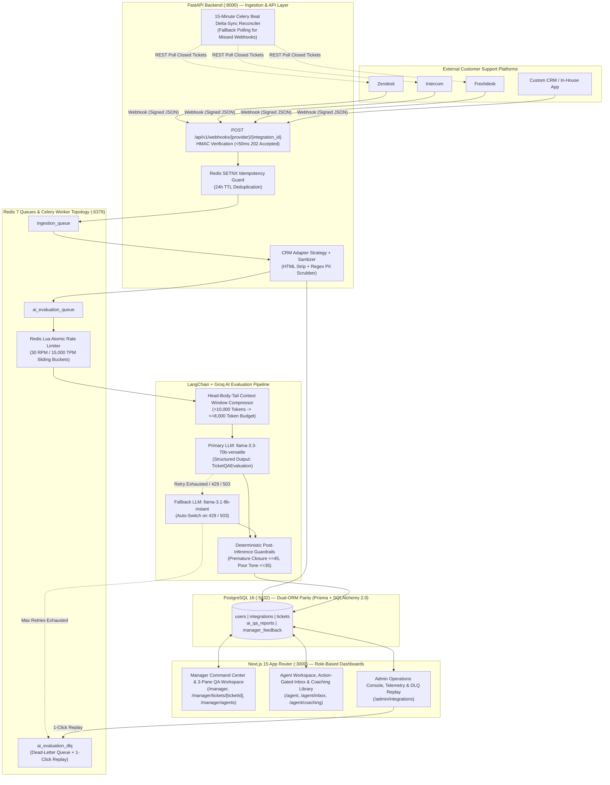

# Customer Support Ticket Summarization & Agent QA Platform

An enterprise-grade, asynchronous **AI Quality Assurance (QA), Ticket Summarization, and Closed-Loop Agent Coaching Platform** built with **Next.js 15 (App Router)**, **FastAPI (Python 3.12 Async)**, **PostgreSQL 16**, **Redis 7 + Celery**, and **LangChain + Groq LPU Inference (`llama-3.3-70b-versatile` & `llama-3.1-8b-instant`)**.

---

## Table of Contents

1. [Project Overview & Core Value Proposition](#1-project-overview--core-value-proposition)
2. [Detailed Breakdown of Every Project Component (How It Works Under the Hood)](#2-detailed-breakdown-of-every-project-component-how-it-works-under-the-hood)
3. [System Requirements & Needed Resources](#3-system-requirements--needed-resources)
4. [Step-by-Step Guide: How to Run the Project](#4-step-by-step-guide-how-to-run-the-project)
5. [How to Configure & Use Your Groq API Key](#5-how-to-configure--use-your-groq-api-key)
6. [How to Connect External Customer Support Apps (CRM Integration Guide)](#6-how-to-connect-external-customer-support-apps-crm-integration-guide)
7. [Developer Guide: How to Modify the Code to Support Multiple LLM Providers](#7-developer-guide-how-to-modify-the-code-to-support-multiple-llm-providers-openai-anthropic-gemini-ollama)
8. [User Walkthrough & Testing Guide](#8-user-walkthrough--testing-guide)

---

## 1. Project Overview & Core Value Proposition

### What Problem Does This Platform Solve?
In most customer support teams, QA managers manually review less than **2% to 5%** of closed support tickets because reading thousands of transcripts by hand is slow and expensive. As a result, critical issues—such as **premature ticket closures** (closing a ticket while the customer is still locked out or frustrated), **poor agent tone**, or **missed billing/security policies**—slip through unnoticed until customer churn increases.

### How This Platform Works (In Simple Terms)
This platform automates **100% of support ticket QA** from the moment a conversation is marked `Closed` or `Solved` in your CRM:
1. **Real-Time Webhook Listener:** Whenever a support agent closes a ticket in **Zendesk**, **Intercom**, **Freshdesk**, or your **Custom CRM**, the platform receives the webhook in under **50 milliseconds** (`202 Accepted`), verifies its cryptographic signature, strips HTML noise, and redacts sensitive customer PII (credit cards, SSNs, phone numbers, emails, API keys).
2. **Automated AI QA Auditor:** A background worker sends the sanitized conversation transcript to an LLM bound to a strict **16-field JSON Schema (`TicketQAEvaluation`)**. The AI summarizes the ticket, identifies the root issue, scores the agent from `0–100` across **Empathy**, **Clarity & Accuracy**, and **Ownership & Efficiency**, flags verbatim quotes proving poor tone or premature closure, and writes concrete **Suggested Phrasing Rewrites**.
3. **Deterministic Post-Inference Guardrails:** Before saving the AI report, deterministic Python guardrails verify the math and enforce hard ceilings:
   - If **Premature Closure** is detected, the agent's overall QA score is automatically capped at **`<= 45`**, `is_resolved_properly` is forced to `False`, and the ticket is flagged in red on the Manager Dashboard.
   - If **Poor Tone** is evidenced in a flagged quote, the overall QA score is capped at **`<= 35`**.
4. **Closed-Loop Manager-to-Agent Coaching:** Support Managers inspect flagged tickets in a **3-Pane Split Workspace** (clicking any AI evidence quote scrolls directly to and highlights that exact message in the transcript) and send structured coaching notes with required action items to the agent. Support Agents must check off every required action item in their **Feedback Inbox** before they can acknowledge the coaching note.

### End-to-End Architecture Diagram



---

## 2. Detailed Breakdown of Every Project Component (How It Works Under the Hood)

### 2.1 Frontend (`frontend/` — Next.js 15 App Router, TypeScript, Tailwind CSS)
- **Unified Cross-Service Authentication (`frontend/src/auth.ts` & `frontend/src/lib/jwt.ts`):**
  - Uses Auth.js v5 (`next-auth`) with Credentials login against PostgreSQL `users` (`bcryptjs` password verification).
  - Mints a shared **`HS256` JWT access token** signed with `AUTH_SECRET` containing `sub` (User UUID), `email`, `role` (`ADMIN`, `MANAGER`, `AGENT`), `external_crm_agent_id`, and `manager_id`. FastAPI verifies this exact Bearer token on every backend API call.
- **Edge RBAC Middleware (`frontend/src/middleware.ts` & `frontend/src/lib/rbac.ts`):**
  - Runs at the Next.js Edge layer before any page renders:
    - Unauthenticated users are redirected to `/login`.
    - `AGENT` users are restricted strictly to `/agent/*` and receive `403`/redirects if they attempt to visit `/manager/*` or `/admin/*`.
    - `MANAGER` users can access `/manager/*` and `/agent/*`.
    - `ADMIN` users have full access to `/admin/*`, `/manager/*`, and `/agent/*`.
- **Dual-Mode Data Fetching Client (`frontend/src/lib/api-client.ts`):**
  - Automatically queries FastAPI (`FASTAPI_INTERNAL_URL`) with `Authorization: Bearer <token>` and seamlessly falls back to direct Prisma queries if FastAPI is temporarily unreachable, ensuring zero-downtime server-side rendering.
- **Manager Command Center & 3-Pane Split Workspace:**
  - `frontend/src/app/(dashboard)/manager/page.tsx`: Team KPI summary cards, daily QA score trend chart, customer sentiment trajectory breakdown, and premature closure alert feed.
  - `frontend/src/app/(dashboard)/manager/tickets/page.tsx`: Filterable, paginated Ticket QA Explorer (filter by `Premature Closure Only`, `Resolution Status`, `Issue Category`, or `Score Range`).
  - `frontend/src/app/(dashboard)/manager/tickets/[ticketId]/page.tsx` & `frontend/src/components/manager/TicketThreePaneWorkspace.tsx`:
    - **Left Pane:** Ticket metadata, SLA response/resolution timings, customer identifier, and assigned agent info.
    - **Center Pane:** Sanitized conversation transcript with turn numbers, sender badges, and dynamic scroll-to-quote highlighting.
    - **Right Pane:** AI QA Scorecard (`0–100`), rubric breakdown (`Empathy`, `Clarity & Accuracy`, `Ownership & Efficiency`), clickable **Flagged Verbatim Evidence Quotes**, **AI Actionable Coaching Plan** (with suggested phrasing rewrites), **Re-Evaluate Ticket** button, and **Manager Coaching Feedback Form**.
- **Agent Portal & Action-Item Completion Gating:**
  - `frontend/src/app/(dashboard)/agent/page.tsx`: Personal QA score trend compared against the team average benchmark.
  - `frontend/src/app/(dashboard)/agent/inbox/page.tsx` & `frontend/src/components/agent/AgentInboxClient.tsx`: Displays coaching notes sent by managers. The **"Acknowledge Feedback"** button is strictly disabled in both UI and backend (`PATCH /api/v1/feedback/{id}/status`) until the agent checks off 100% of the required action items.
  - `frontend/src/app/(dashboard)/agent/coaching/page.tsx`: Searchable library of AI-generated coaching steps and phrasing rewrites across all of the agent's evaluated tickets.
- **Admin Operations, Telemetry & DLQ Console:**
  - `frontend/src/app/(dashboard)/admin/integrations/page.tsx` & `frontend/src/components/admin/AdminOperationsConsole.tsx`: Displays real-time `p50`/`p95`/`p99` LLM inference latency (`ms`), prompt/completion token usage, fallback model invocation rate (`%`), active CRM integrations with masked `AES-256-GCM` secrets, **"Trigger Delta-Sync Now"**, and **1-Click Dead-Letter Queue (`ai_evaluation_dlq`) Replay**.

### 2.2 Backend API & Webhook Engine (`backend/app/api/` & `backend/app/integrations/`)
- **Non-Blocking Webhook Receiver (`backend/app/api/v1/webhooks.py`):**
  - Exposes `POST /api/v1/webhooks/{provider}/{integration_id}`.
  - Resolves the active integration config from an in-memory/Redis cache so hot-path webhooks perform zero blocking SQL queries on the request thread.
  - Validates provider-specific HMAC signatures and enforces a **300-second replay window** (`401 Unauthorized` on mismatch or expired timestamp).
  - Ignores non-closed ticket events immediately (`200 OK` with `{"status": "IGNORED_NOT_CLOSED"}`).
  - Checks Redis `SETNX` idempotency (`webhook:dedup:{crm_type}:{external_ticket_id}:{closed_at}`) with a 24-hour TTL so duplicate CRM webhook deliveries never create duplicate database rows or duplicate LLM calls.
  - Pushes the job to `ingestion_queue` and returns `202 Accepted` in **< 50ms**.
- **CRM Adapter Strategy Pattern (`backend/app/integrations/`):**
  - `base.py` (`BaseCRMConnector`), `registry.py` (`ProviderRegistry`), `zendesk.py` (`ZendeskConnector`), `intercom.py` (`IntercomConnector`), `freshdesk.py` (`FreshdeskConnector`), and `custom.py` (`CustomCRMConnector`).
  - Every connector converts raw provider JSON into a unified Pydantic `StandardTicketPayload` (`backend/app/schemas/ticket_payload.py`).
- **Stage-1 Pre-Processing & PII Scrubber (`backend/app/services/sanitizer.py`):**
  - Strips HTML tags, scripts/styles, and quoted email reply chains (`On ... wrote:`).
  - Redacts sensitive PII using compiled regexes before any text is stored or sent to an LLM:
    - Credit Cards -> `[REDACTED_CREDIT_CARD]`
    - US SSNs -> `[REDACTED_SSN]`
    - Phone Numbers -> `[REDACTED_PHONE]`
    - API Keys / Bearer Tokens -> `[REDACTED_API_KEY]`
    - Email Addresses -> `[REDACTED_EMAIL]`
  - Collapses consecutive automated bot/system messages to save context tokens.
- **AES-256-GCM Credential Encryption (`backend/app/core/crypto.py`):**
  - Encrypts CRM API keys and webhook secrets at rest (`enc_aes256gcm_v1:<nonce>:<ciphertext+tag>`) using a 256-bit key derived from `ENCRYPTION_KEY` / `ENCRYPTION_MASTER_KEY`.

### 2.3 Async Queue & Distributed Rate Limiter (`backend/app/worker/` & `backend/app/ai/rate_limiter.py`)
- **3-Queue Celery Topology (`backend/app/worker/celery_app.py` & `backend/app/worker/tasks.py`):**
  1. `ingestion_queue` (`process_webhook_ingestion_task`): Normalizes, sanitizes, and persists closed tickets into PostgreSQL with `processing_status = QUEUED`.
  2. `ai_evaluation_queue` (`evaluate_ticket_ai_qa_task`): Runs the LangChain + Groq evaluation pipeline.
  3. `ai_evaluation_dlq` (`handle_ai_evaluation_dlq_task`): Captures tickets that exhausted all primary and fallback model retries, marking them `FAILED_RETRYABLE` with `last_dlq_error` metadata for 1-click replay in the Admin Console.
- **15-Minute Celery Beat Reconciler:** Automatically polls active CRM integrations every 15 minutes (`reconcile_missed_closed_tickets_task`) to catch any closed tickets whose webhooks were dropped during network outages.
- **Redis Lua Dual-Bucket Rate Limiter (`backend/app/ai/rate_limiter.py`):**
  - Executes an atomic Lua script inside Redis enforcing both **Requests Per Minute (`GROQ_RPM_LIMIT`, default `30`)** and **Tokens Per Minute (`GROQ_TPM_LIMIT`, default `15,000`)** across all concurrent worker processes.
  - When a burst of 100 tickets arrives simultaneously, excess tasks receive a precise `retry_after_seconds` backoff instead of triggering `HTTP 429 Too Many Requests` from Groq.

### 2.4 AI Evaluation Pipeline (`backend/app/ai/`)
- **Head-Body-Tail Context Window Compressor (`backend/app/ai/context_window.py`):**
  - Counts transcript tokens using `tiktoken` (`cl100k_base`).
  - Transcripts `<= 10,000` tokens pass through verbatim.
  - Transcripts `> 10,000` tokens are compressed into an `<= 8,000`-token budget while preserving critical evidence:
    - **Head (First 3 turns):** Preserved verbatim (captures initial customer problem and expectations).
    - **Body (Middle turns):** Status changes, escalations, and supervisor notes are kept verbatim; routine middle chunks are summarized into `[COMPRESSED MIDDLE SEGMENT ...]` blocks using `llama-3.1-8b-instant`.
    - **Tail (Last 6 turns):** Preserved 100% verbatim (essential for detecting premature closure and final customer sentiment).
- **Structured Outputs (`backend/app/schemas/qa_evaluation.py` & `backend/app/ai/evaluator.py`):**
  - Binds `ChatGroq` (`temperature=0.0`) with `.with_structured_output(TicketQAEvaluation, method="json_schema", include_raw=True)` to guarantee all 16 required fields (`summary`, `core_issue`, `issue_category`, `resolution_status`, `is_resolved_properly`, `premature_closure_detected`, `premature_closure_reason`, `agent_score`, `empathy_rating`, `clarity_and_accuracy_rating`, `ownership_and_efficiency_rating`, `customer_sentiment_trajectory`, `strengths`, `areas_for_improvement`, `flagged_evidence_quotes`, `actionable_coaching_plan`).
  - Automatically falls back from `llama-3.3-70b-versatile` to `llama-3.1-8b-instant` with exponential backoff + jitter if the primary model experiences transient `429`/`503` errors.
- **Post-Inference Deterministic Guardrails (`apply_qa_scoring_guardrails` in `backend/app/schemas/qa_evaluation.py`):**
  - Enforces hard business rules regardless of raw LLM output:
    - **Premature Closure Cap:** If `premature_closure_detected == True` or `resolution_status == PREMATURELY_CLOSED` or any flagged quote has `issue_type == PREMATURE_CLOSURE`, `agent_score` is clamped to **`<= 45`**, `resolution_status` is set to `PREMATURELY_CLOSED`, and `is_resolved_properly` is forced to `False`.
    - **Poor Tone Cap:** If any flagged quote has `issue_type == POOR_TONE`, `agent_score` is clamped to **`<= 35`**.

### 2.5 Database Layer (`frontend/prisma/schema.prisma` & `backend/app/models/`)
Prisma (used by Next.js migrations, seeding, and BFF fallback) and SQLAlchemy 2.0 Async (used by FastAPI and Celery workers) share 100% identical table names, column types, and PostgreSQL native enums across **5 core tables**:
1. **`users`**: Accounts with `role` (`ADMIN`, `MANAGER`, `AGENT`), `external_crm_agent_id` (maps CRM assignees to platform users), and self-referencing `manager_id`.
2. **`integrations`**: Multi-tenant CRM connector registry storing `crm_type`, `encrypted_api_key`, `encrypted_webhook_secret`, `webhook_Diagnostic_status`, and `last_successful_sync_at`.
3. **`tickets`**: Normalized closed tickets with composite unique constraint `(integration_id, external_ticket_id, ticket_closed_at)`, `processing_status` (`QUEUED`, `PROCESSING`, `EVALUATED`, `FAILED_RETRYABLE`, `FAILED_PERMANENT`), and `raw_transcript` (`JSONB`).
4. **`ai_qa_reports`**: 1-to-1 AI evaluation results linked to `tickets`, storing the 16 rubric fields, `model_used`, `prompt_tokens`, `completion_tokens`, and `inference_latency_ms`.
5. **`manager_feedback`**: Coaching notes dispatched by managers to agents, including `coaching_priority`, `action_items` (`JSONB`), `read_status` (`UNREAD`, `READ`, `ACKNOWLEDGED`), and `acknowledged_at`.

---

## 3. System Requirements & Needed Resources

### 3.1 Software Prerequisites

| Requirement | Minimum Version | Recommended Version | Purpose |
| :--- | :--- | :--- | :--- |
| **Node.js & npm** | `v20.10+` | `v20 LTS` or `v22 LTS` | Next.js 15 App Router, Prisma CLI, Vitest |
| **Python** | `3.12+` | `3.12.x` | FastAPI Async Backend, Celery Workers, LangChain, Pytest |
| **Docker & Docker Compose** | `v24.0+` / `v2.20+` | Latest Stable | Running PostgreSQL 16, Redis 7, and production containers |
| **PostgreSQL** | `16.x` | `16-alpine` (via Docker) | Primary relational + `JSONB` datastore |
| **Redis** | `7.x` | `7-alpine` (via Docker) | Celery message broker, `SETNX` idempotency, Lua rate limiter |

### 3.2 Hardware & Cloud Compute Sizing Guide

| Environment / Ticket Volume | Total vCPU | Total RAM | Disk (SSD) | Recommended Process Topology |
| :--- | :--- | :--- | :--- | :--- |
| **Local Development / Demo**<br/>*(Up to 500 tickets/day)* | **2 vCPU** | **4 GB RAM** | **10 GB SSD** | Single machine running Docker (`postgres`, `redis`), `uvicorn` (1 worker), and `next dev` / `next start`. |
| **Small / Medium Production**<br/>*(500 – 10,000 tickets/day)* | **4 vCPU** | **8 GB RAM** | **40 GB NVMe** | • **Next.js 15:** 1 vCPU, 2 GB RAM<br/>• **FastAPI + Celery Worker (`c=4`):** 2 vCPU, 3 GB RAM<br/>• **PostgreSQL 16 + Redis 7:** 1 vCPU, 3 GB RAM |
| **High-Volume Enterprise**<br/>*(10,000 – 100,000+ tickets/day)* | **8–16 vCPU** | **16–32 GB RAM** | **100+ GB NVMe** | • **Next.js 15:** 2+ replicas behind load balancer<br/>• **FastAPI Webhook Tier:** 4 Gunicorn/Uvicorn workers<br/>• **Dedicated Celery Workers:** Separate `ingestion_queue` and `ai_evaluation_queue` pools<br/>• **Managed PostgreSQL 16 & Redis 7** |

---

## 4. Step-by-Step Guide: How to Run the Project

### Option A: One-Command Quick Start (Fastest Way to Launch & Test Live)

From the root of the repository, run:

```bash
# 1. Start PostgreSQL 16, Redis 7, FastAPI (:8000), and Next.js (:3000)
./start-dev.sh
```

In a second terminal window, simulate two live Zendesk webhook deliveries (one **Prematurely Closed** red-alert ticket and one **Properly Resolved** high-empathy billing ticket):

```bash
# 2. Fire 2 signed Zendesk webhooks and run end-to-end AI QA evaluation
python3 scripts/simulate_live_webhook.py
```

The script will output the webhook `202 Accepted` latency, the AI QA scores (`38/100` and `91/100`), and the direct URLs to open both tickets in your browser (`http://localhost:3000/manager/tickets`).

---

### Option B: Manual Step-by-Step Setup (Full Developer Control)

#### Step 1: Start PostgreSQL 16 and Redis 7 Containers
```bash
docker compose up -d postgres redis
```

#### Step 2: Configure Environment Variables
Copy `.env.example` to `.env` in the project root (and ensure `frontend/.env` has matching `DATABASE_URL` and `AUTH_SECRET`):
```bash
cp .env.example .env
```

#### Step 3: Install Frontend Dependencies, Run Prisma Migrations & Seed Demo Data
```bash
cd frontend
npm install
npx prisma generate
npx prisma migrate deploy
npm run db:seed
cd ..
```

#### Step 4: Install Python Dependencies & Start FastAPI Backend
```bash
pip install --upgrade pip
pip install -r backend/requirements.txt

# Start FastAPI on http://0.0.0.0:8000
PYTHONPATH=backend uvicorn app.main:app --app-dir backend --host 0.0.0.0 --port 8000 --reload
```

#### Step 5: (Optional) Start Celery Worker & Celery Beat Reconciler
Open a new terminal in the repository root:
```bash
# Start Celery worker consuming all 3 queues
PYTHONPATH=backend celery -A app.worker.celery_app worker --workdir backend -Q ingestion_queue,ai_evaluation_queue,ai_evaluation_dlq --loglevel=info

# Start Celery Beat 15-minute fallback delta-sync scheduler
PYTHONPATH=backend celery -A app.worker.celery_app beat --workdir backend --loglevel=info
```

#### Step 6: Start Next.js 15 Frontend
Open a new terminal in `frontend/`:
```bash
cd frontend
npm run dev
```
Visit **`http://localhost:3000`** in your browser.

---

### Option C: Full Production Docker Compose Deployment

To build and run the entire stack (`postgres`, `redis`, `backend`, `celery_worker`, `celery_beat`, and `frontend`) inside production Docker containers:

```bash
docker compose --profile prod up --build -d
```

Check container status and logs:
```bash
docker compose --profile prod ps
docker compose --profile prod logs -f backend frontend
```

---

### Seeded Demo Accounts & Login Credentials

All seeded demo users share the password: **`Password123!`**

| Role | Email | Password | External CRM Agent ID | Default Dashboard URL | What You Can Do |
| :--- | :--- | :--- | :--- | :--- | :--- |
| **MANAGER** | `manager@qa-platform.local` | `Password123!` | — | `http://localhost:3000/manager` | View team QA analytics, filter tickets, inspect 3-pane workspace, click evidence quotes, send coaching feedback |
| **AGENT** *(Sarah Jenkins)* | `sarah.agent@qa-platform.local` | `Password123!` | `zd_agent_101` | `http://localhost:3000/agent` | View personal QA score trends, check off required action items in Feedback Inbox, browse AI Coaching Library |
| **AGENT** *(Omar Hassan)* | `omar.agent@qa-platform.local` | `Password123!` | `zd_agent_102` | `http://localhost:3000/agent` | Inspect assigned tickets (including premature closure coaching alerts) and acknowledge manager feedback |
| **ADMIN** | `admin@qa-platform.local` | `Password123!` | — | `http://localhost:3000/admin/integrations` | Monitor `p50`/`p95`/`p99` LLM latency & token usage, add CRM connectors, trigger delta-sync, replay DLQ tickets |

---

## 5. How to Configure & Use Your Groq API Key

### 5.1 Obtaining a Groq API Key
1. Sign in to the [GroqCloud Console](https://console.groq.com).
2. Navigate to **API Keys** and click **Create API Key**.
3. Copy your generated key (keep it private and never commit it to Git).

### 5.2 Configuring `.env` for Groq LPU Inference
Open your root `.env` file and set the following environment variables (defined in [`backend/app/core/config.py`](file:///workspaces/codespaces-blank/myapps-anti/Customer%20Support%20Ticket%20Summarization%20&%20Agent%20QA%20Platform/backend/app/core/config.py)):

```env
# --- Groq LPU Inference & Rate Limiting Configuration ---
GROQ_API_KEY="<YOUR_GROQ_API_KEY>"

# Primary high-reasoning model for 16-field structured QA evaluation
GROQ_PRIMARY_MODEL="llama-3.3-70b-versatile"

# Fast fallback model automatically used on HTTP 429 / 503 errors
GROQ_FALLBACK_MODEL="llama-3.1-8b-instant"

# Fast model used to summarize middle chunks of >10,000-token transcripts
GROQ_COMPRESSION_MODEL="llama-3.1-8b-instant"

# Distributed Redis Lua Sliding-Window Rate Limits (adjust to match your Groq tier)
GROQ_RPM_LIMIT=30
GROQ_TPM_LIMIT=15000
TRANSCRIPT_MAX_VERBATIM_TOKENS=10000
```

### 5.3 Live Groq LPU Mode vs. Offline Deterministic Mode
The evaluator in [`backend/app/ai/evaluator.py`](file:///workspaces/codespaces-blank/myapps-anti/Customer%20Support%20Ticket%20Summarization%20&%20Agent%20QA%20Platform/backend/app/ai/evaluator.py) supports two seamless operating modes:
- **When `GROQ_API_KEY` is set to a valid key:**
  - `GroqTicketEvaluator` invokes `ChatGroq` (`llama-3.3-70b-versatile`, `temperature=0.0`) using `.with_structured_output(TicketQAEvaluation, method="json_schema", include_raw=True)`.
  - If the primary model returns a rate-limit (`429`) or service unavailable (`503`) error after exponential backoff retries, it automatically switches to `GROQ_FALLBACK_MODEL` (`llama-3.1-8b-instant`) and records `fallback_model_used = True` in telemetry.
  - Real `prompt_tokens`, `completion_tokens`, and `inference_latency_ms` from Groq's response metadata are saved to `ai_qa_reports` and surfaced in the Admin Telemetry Console.
- **When `GROQ_API_KEY` is empty (`""`) in local dev or CI:**
  - The platform automatically runs its built-in deterministic rubric analyzer (`analyze_transcript_deterministically`) followed by the exact same `apply_qa_scoring_guardrails`. This allows developers and CI pipelines to test webhooks, queues, premature closure alerts, and dashboards offline with zero external API cost.

---

## 6. How to Connect External Customer Support Apps (CRM Integration Guide)

### Step 1: Register Your CRM Connector in the Admin Console
1. Log in as **`admin@qa-platform.local`** (`Password123!`) and open **`http://localhost:3000/admin/integrations`**.
2. In the **"Add New CRM Integration"** panel:
   - Select **CRM Provider**: `ZENDESK`, `INTERCOM`, `FRESHDESK`, or `CUSTOM`.
   - Enter your **Subdomain / Base URL** (e.g., `acme-support.zendesk.com`).
   - Enter your **CRM API Key** (used for fallback delta-sync polling) and **Webhook Signing Secret** (used to verify incoming webhook signatures).
3. Click **Save Integration**.
   - The backend immediately encrypts both secrets using **AES-256-GCM** (`enc_aes256gcm_v1:...`) before storing them in PostgreSQL (`integrations` table).
   - Copy the generated **Webhook Endpoint URL** displayed on the integration card:
     ```text
     https://<your-domain-or-ngrok>/api/v1/webhooks/{provider}/{integration_id}
     ```

---

### Step 2: Configure Webhooks in Your External CRM

#### A. Zendesk Integration (`/api/v1/webhooks/zendesk/{integration_id}`)
1. In **Zendesk Admin Center**, go to **Apps and integrations -> Webhooks -> Create webhook**.
2. Select **Trigger or Automation** and configure:
   - **Endpoint URL:** `https://<your-domain>/api/v1/webhooks/zendesk/<integration_id>`
   - **Request method:** `POST`
   - **Request format:** `JSON`
   - Copy the **Signing secret** shown by Zendesk and paste it into the platform's **Webhook Signing Secret** when creating the integration.
3. In **Objects and rules -> Business rules -> Triggers**, create a trigger that fires when **`Ticket: Status` `Changed to` `Closed`** (or `Solved`) and sends the JSON payload with comments.
4. **How Verification Works:** [`ZendeskConnector`](file:///workspaces/codespaces-blank/myapps-anti/Customer%20Support%20Ticket%20Summarization%20&%20Agent%20QA%20Platform/backend/app/integrations/zendesk.py) validates `X-Zendesk-Webhook-Signature` and `X-Zendesk-Webhook-Signature-Timestamp` using `Base64(HMAC-SHA256(timestamp + raw_body, secret))` within a 300-second replay window.

#### B. Intercom Integration (`/api/v1/webhooks/intercom/{integration_id}`)
1. In the **Intercom Developer Hub**, open your app -> **Webhooks**.
2. Set the **Endpoint URL** to:
   ```text
   https://<your-domain>/api/v1/webhooks/intercom/<integration_id>
   ```
3. Subscribe to the topic **`conversation.admin.closed`**.
4. Use your Intercom **Client Secret** as the integration's **Webhook Signing Secret**.
5. **How Verification Works:** [`IntercomConnector`](file:///workspaces/codespaces-blank/myapps-anti/Customer%20Support%20Ticket%20Summarization%20&%20Agent%20QA%20Platform/backend/app/integrations/intercom.py) validates `X-Hub-Signature-256` (`sha256=<hex_hmac_digest>`) and normalizes `conversation_parts` into the conversation thread.

#### C. Freshdesk Integration (`/api/v1/webhooks/freshdesk/{integration_id}`)
1. In **Freshdesk Admin -> Workflows -> Automations -> Ticket Updates**, create a rule triggered when **Status is changed to Closed**.
2. Choose **Trigger Webhook (`POST`)** pointing to:
   ```text
   https://<your-domain>/api/v1/webhooks/freshdesk/<integration_id>
   ```
3. Configure either an HMAC `X-Webhook-Signature` header or pass your secret in `X-Integration-Api-Key`.

#### D. Custom CRM / In-House Ticketing System (`/api/v1/webhooks/custom/{integration_id}`)
Any internal helpdesk, chat widget, or custom ticketing service can push closed conversations directly to `/api/v1/webhooks/custom/{integration_id}` using either:
- Header `X-Integration-Api-Key: your_webhook_secret_here`, **OR**
- Header `X-Webhook-Signature: sha256=<hex_hmac_sha256>` + `X-Webhook-Timestamp: <unix_epoch_seconds>`

**Copy-Pasteable `curl` Example for Custom CRM Ingestion:**

```bash
curl -X POST "http://localhost:8000/api/v1/webhooks/custom/<YOUR_INTEGRATION_UUID>" \
  -H "Content-Type: application/json" \
  -H "X-Integration-Api-Key: your_webhook_secret_here" \
  -d '{
    "ticket": {
      "external_ticket_id": "CUSTOM-TKT-9001",
      "status": "closed",
      "subject": "API webhook retries failing with TLS handshake error",
      "priority": "high",
      "channel": "EMAIL",
      "external_agent_id": "zd_agent_101",
      "agent_name": "Sarah Jenkins",
      "agent_email": "sarah.agent@qa-platform.local",
      "customer_identifier": "enterprise_client_77",
      "created_at": "2026-10-29T14:00:00Z",
      "closed_at": "2026-10-29T14:18:00Z",
      "tags": ["api", "tls", "enterprise"],
      "messages": [
        {
          "message_id": "m_01",
          "sender_role": "CUSTOMER",
          "sender_name": "Alex Rivera",
          "timestamp": "2026-10-29T14:00:00Z",
          "content": "Our webhook listener started rejecting requests after we enabled TLS 1.3 only."
        },
        {
          "message_id": "m_02",
          "sender_role": "AGENT",
          "sender_name": "Sarah Jenkins",
          "timestamp": "2026-10-29T14:12:00Z",
          "content": "I see the issue! I have updated your outbound webhook cipher suite profile to TLS 1.3 and verified test deliveries are returning 200 OK."
        },
        {
          "message_id": "m_03",
          "sender_role": "CUSTOMER",
          "sender_name": "Alex Rivera",
          "timestamp": "2026-10-29T14:17:00Z",
          "content": "Confirmed, events are flowing again. Thank you!"
        }
      ]
    }
  }'
```

### Step 3: Fallback Delta-Sync Polling (Recovering Missed Webhooks)
If your firewall or CRM experiences a temporary outage and a webhook delivery is missed:
- **Automated Every 15 Minutes:** Celery Beat runs `reconcile_missed_closed_tickets_task` ([`backend/app/worker/tasks.py`](file:///workspaces/codespaces-blank/myapps-anti/Customer%20Support%20Ticket%20Summarization%20&%20Agent%20QA%20Platform/backend/app/worker/tasks.py)), querying each active integration's REST API for tickets closed since `last_successful_sync_at` and ingesting any missing records.
- **Manual One-Click Sync:** In the Admin Console (`http://localhost:3000/admin/integrations`), click **"Trigger Delta-Sync Now"** on any integration card (calls `POST /api/v1/integrations/{id}/sync`).

---

## 7. Developer Guide: How to Modify the Code to Support Multiple LLM Providers (OpenAI, Anthropic, Gemini, Ollama)

Because the AI pipeline in [`backend/app/ai/evaluator.py`](file:///workspaces/codespaces-blank/myapps-anti/Customer%20Support%20Ticket%20Summarization%20&%20Agent%20QA%20Platform/backend/app/ai/evaluator.py) uses **LangChain's standard `.with_structured_output(TicketQAEvaluation)` interface**, you can add **OpenAI (`gpt-4o`)**, **Anthropic (`claude-3-5-sonnet`)**, **Google Gemini (`gemini-2.5-pro`)**, or **Local Ollama (`llama3.2`)** in 3 steps without changing a single line of the database models, post-inference guardrails, Celery workers, or Next.js frontend.

### Step 1: Install the Desired LangChain Provider Package(s)
Add the provider package to `backend/requirements.txt` and install it:

```bash
# Pick one or more providers:
pip install langchain-openai        # For OpenAI (gpt-4o, gpt-4o-mini)
pip install langchain-anthropic     # For Anthropic Claude (claude-3-5-sonnet-latest)
pip install langchain-google-genai  # For Google Gemini (gemini-2.5-pro, gemini-2.5-flash)
pip install langchain-ollama        # For Local Ollama models (llama3.2, qwen2.5)
```

### Step 2: Add Provider Settings to `backend/app/core/config.py`
Open [`backend/app/core/config.py`](file:///workspaces/codespaces-blank/myapps-anti/Customer%20Support%20Ticket%20Summarization%20&%20Agent%20QA%20Platform/backend/app/core/config.py) and add the multi-provider fields to `Settings`:

```python
class Settings(BaseSettings):
    # ... existing fields ...

    # Multi-Provider LLM Routing ("groq" | "openai" | "anthropic" | "google" | "ollama")
    LLM_PROVIDER: str = "groq"

    # Provider API Keys (always use environment variables in .env, never hardcode keys)
    GROQ_API_KEY: str = ""
    OPENAI_API_KEY: str = ""
    ANTHROPIC_API_KEY: str = ""
    GOOGLE_API_KEY: str = ""
    OLLAMA_BASE_URL: str = "http://localhost:11434"

    # Primary & Fallback Model Names (customizable per provider in .env)
    GROQ_PRIMARY_MODEL: str = "llama-3.3-70b-versatile"
    GROQ_FALLBACK_MODEL: str = "llama-3.1-8b-instant"
```

In your `.env` file, set your chosen provider and placeholder-safe API key:
```env
LLM_PROVIDER="openai"
OPENAI_API_KEY="<YOUR_OPENAI_API_KEY>"
GROQ_PRIMARY_MODEL="gpt-4o"
GROQ_FALLBACK_MODEL="gpt-4o-mini"
```

### Step 3: Update `_build_chat_groq_structured_runnable` in `backend/app/ai/evaluator.py`
Open [`backend/app/ai/evaluator.py`](file:///workspaces/codespaces-blank/myapps-anti/Customer%20Support%20Ticket%20Summarization%20&%20Agent%20QA%20Platform/backend/app/ai/evaluator.py) and replace `_build_chat_groq_structured_runnable` with a multi-provider factory method:

```python
from langchain_groq import ChatGroq
from app.core.config import settings
from app.schemas.qa_evaluation import TicketQAEvaluation


def build_structured_llm_runnable(model_name: str) -> Any:
    """
    Multi-provider factory that binds `.with_structured_output(TicketQAEvaluation, include_raw=True)`
    across Groq, OpenAI, Anthropic, Google Gemini, or local Ollama.
    """
    provider = settings.LLM_PROVIDER.strip().lower()

    if provider == "openai":
        from langchain_openai import ChatOpenAI

        llm = ChatOpenAI(
            model=model_name,
            api_key=settings.OPENAI_API_KEY,
            temperature=0.0,
            max_tokens=2048,
            timeout=30.0,
        )
        return llm.with_structured_output(
            TicketQAEvaluation,
            method="json_schema",
            include_raw=True,
        )

    if provider == "anthropic":
        from langchain_anthropic import ChatAnthropic

        llm = ChatAnthropic(
            model=model_name,
            api_key=settings.ANTHROPIC_API_KEY,
            temperature=0.0,
            max_tokens=2048,
            timeout=30.0,
        )
        return llm.with_structured_output(
            TicketQAEvaluation,
            include_raw=True,
        )

    if provider == "google":
        from langchain_google_genai import ChatGoogleGenerativeAI

        llm = ChatGoogleGenerativeAI(
            model=model_name,
            google_api_key=settings.GOOGLE_API_KEY,
            temperature=0.0,
            max_output_tokens=2048,
        )
        return llm.with_structured_output(
            TicketQAEvaluation,
            include_raw=True,
        )

    if provider == "ollama":
        from langchain_ollama import ChatOllama

        llm = ChatOllama(
            model=model_name,
            base_url=settings.OLLAMA_BASE_URL,
            temperature=0.0,
        )
        return llm.with_structured_output(
            TicketQAEvaluation,
            include_raw=True,
        )

    # Default: Groq LPU Inference
    llm = ChatGroq(
        model=model_name,
        api_key=settings.GROQ_API_KEY,
        temperature=0.0,
        max_tokens=2048,
        timeout=30.0,
        max_retries=1,
    )
    return llm.with_structured_output(
        TicketQAEvaluation,
        method="json_schema",
        include_raw=True,
    )
```

Because `_invoke_single_runnable()` in [`backend/app/ai/evaluator.py`](file:///workspaces/codespaces-blank/myapps-anti/Customer%20Support%20Ticket%20Summarization%20&%20Agent%20QA%20Platform/backend/app/ai/evaluator.py) already extracts `parsed`, `usage_metadata`, and `response_metadata` generically from any LangChain `AIMessage`, all token counters, latency percentiles (`p50`/`p95`/`p99`), and `apply_qa_scoring_guardrails()` work out-of-the-box with every provider above.

---

## 8. User Walkthrough & Testing Guide

### 8.1 Interactive Browser Walkthrough

1. **Test the Manager Experience (`manager@qa-platform.local` / `Password123!`):**
   - Log in at `http://localhost:3000/login` -> automatically lands on `/manager`.
   - Review the **Team QA Overview** KPI cards, daily score trend chart, and sentiment distribution.
   - Click **Ticket Explorer** (`/manager/tickets`) and toggle **"Premature Closure Only"** to isolate high-risk tickets closed before resolution.
   - Click any ticket row to open the **3-Pane Split QA Workspace** (`/manager/tickets/[ticketId]`):
     - In the right pane under **Flagged Verbatim Evidence Quotes**, click a quote card -> watch the center transcript pane smoothly scroll to and highlight that exact turn.
     - Review the **AI Actionable Coaching Plan** and suggested phrasing rewrites.
     - Scroll to the bottom of the right pane, fill out the **Manager Coaching Feedback Form** with 2 action items, and click **Dispatch Coaching to Agent**.
2. **Test the Support Agent Experience (`sarah.agent@qa-platform.local` or `omar.agent@qa-platform.local` / `Password123!`):**
   - Log in at `http://localhost:3000/login` -> automatically lands on `/agent`.
   - Open **Feedback Inbox** (`/agent/inbox`).
   - Select an unacknowledged coaching card -> notice that the **"Acknowledge Feedback"** button is locked/disabled until you check every action-item checkbox.
   - Check all action items and click **Acknowledge Feedback** -> status transitions to `ACKNOWLEDGED` with a timestamp visible to the Manager.
   - Open **AI Coaching Library** (`/agent/coaching`) to review historical AI phrasing rewrites across your evaluated tickets.
3. **Test the Admin Experience (`admin@qa-platform.local` / `Password123!`):**
   - Log in at `http://localhost:3000/login` -> lands on `/admin/integrations`.
   - Inspect live **`p50` / `p95` / `p99` Inference Latency (`ms`)**, **Prompt & Completion Token Usage**, and **Fallback Model Rate (`%`)**.
   - Click **"Trigger Delta-Sync Now"** on the active Zendesk connector to run on-demand reconciliation.
   - Inspect the **Dead-Letter Queue (`ai_evaluation_dlq`)** table and test **1-Click Replay**.

---

### 8.2 Running the Full Automated Verification Suites

#### 1. Backend Pytest Suite (35 End-to-End Tests across Phases 1–5)
```bash
pytest -v
```
Verifies:
- PostgreSQL + Redis health checks, Prisma/SQLAlchemy schema & enum parity, HS256 JWT authentication, and RBAC route protection (`401`/`403`/`200`).
- `AES-256-GCM` encryption roundtrips, HTML/email quote stripping, PII regex redaction, and HMAC verification across Zendesk, Intercom, Freshdesk, and Custom connectors.
- Sub-50ms `202 Accepted` webhook ingestion, Redis `SETNX` idempotency deduplication, and delta-sync reconciliation.
- Head-Body-Tail context window compression (`>10,000` tokens -> `<=8,000` tokens), Redis Lua sliding-window rate limiting (`30 RPM` / `15,000 TPM`), post-inference scoring guardrails, **20-ticket gold-standard evaluation accuracy (`MAE <= 5.0`)**, and **100-ticket burst resiliency**.
- Manager analytics, ticket filtering, coaching feedback loop, Agent action-item completion gating, Admin telemetry percentiles, 1-click DLQ replay, and **100-webhook high-concurrency load verification (`p95 < 75ms`, `0%` `5xx` errors)**.

#### 2. Frontend Vitest Unit Suite & Strict TypeScript Verification
```bash
cd frontend
npm test
npx tsc --noEmit
npm run build
```
